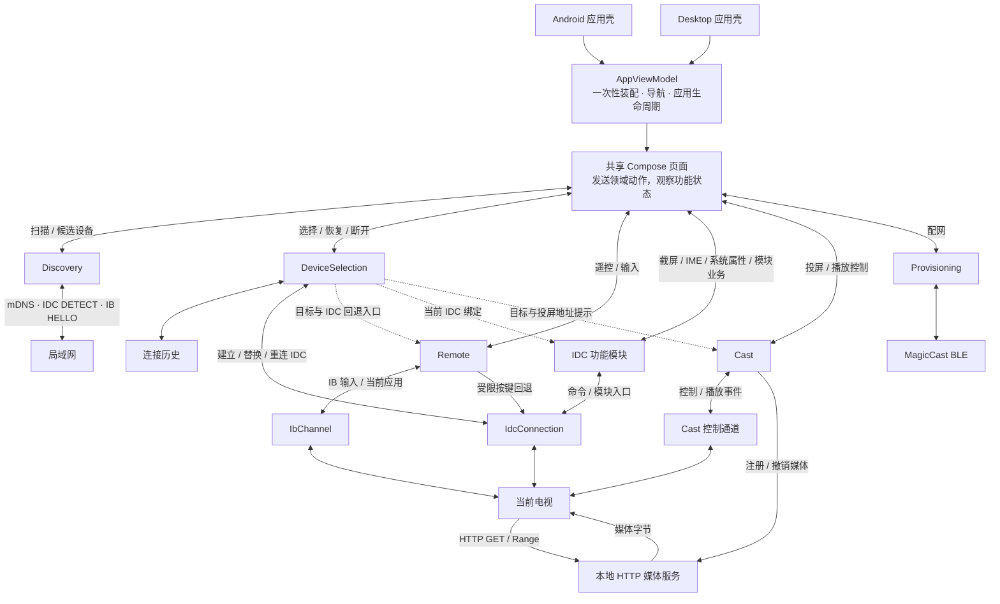

# TVLink 目标架构

**状态：双方共同确认的设计。第一阶段纵向路径已实现并通过回环验证；其余实施切片与真机验收不作为已完成事项声明。**

本文件是目标架构的唯一正式说明。当前实现入口见 `README.md`；协议行为仍以 `docs/re/` 为基准。设计评审过程不属于持续维护的架构事实来源。

## 1. 架构目标

- Android 与 Desktop 共享业务语义和 Compose UI，平台差异由真实系统能力承载。
- 发现面向局域网，正式控制面向一个明确选中的设备。
- 一个目标可同时拥有 IDC、IB、Cast 等通道；通道独立就绪、降级和失效。
- 命令、响应、媒体 URL、模块绑定和后台任务不得跨目标或跨连接串用。
- 高频输入、请求响应和大文件媒体分别采用符合其语义的数据路径。
- 每种状态和每项资源只有一个所有者；常见变化应集中在少数模块。
- 不使用全局事件总线、通用功能接口、统一 Socket 基类或包揽全部命令的 `dispatch()`。

## 2. 总体结构



虚线表示功能订阅 `DeviceSelection` 发布的绑定数据。功能按绑定管理自己的资源。

依赖规则：

- 页面依赖功能接口，不依赖 Socket、协议帧或原始连接。
- `AppViewModel` 负责装配和导航，不拥有具体协议状态。
- `DeviceSelection` 不知道 Remote、Cast 或其他功能清单。
- 协议与平台实现不知道页面和导航。
- 新 IDC 功能不得要求 `DeviceSelection` 增加业务分支。

## 3. 模块职责与资源所有权

| 模块 | 状态与职责 | 拥有的资源 |
|---|---|---|
| `Discovery` | 扫描状态、候选设备、发现归并 | 当前扫描的探测任务与回调 |
| `DeviceSelection` | 当前目标、连接模式、选择身份、IDC 进度、历史恢复 | IDC 连接及其连接级状态 |
| `Remote` | 输入模式、IB 就绪、输入路由、当前应用 | IB 连接、输入队列与重试任务 |
| `ImeFeature` | 遥控页中的 IDC 远程输入会话 | 当前 IDC 上的 IME 操作状态 |
| `ScreenshotFeature` / `SysPropFeature` | 各自命令、应答、超时和页面状态 | 自己尚未完成的 IDC 操作 |
| `AppsFeature` / `AsrFeature` / 在线 Dongle 设置 | 各自业务协议、状态与结果 | 自己的模块绑定和业务操作 |
| `Cast` | 媒体选择、注册、控制、供片和播放状态 | Cast 控制通道、HTTP 服务、媒体 Lease |
| `Provisioning` | 独立 BLE 配网用例 | 当前配网操作及 BLE 资源 |
| `History Storage` | 持久化明确选择和可复用提示 | 平台存储适配器 |

目标撤销统一使用身份和取消信号，但**不建立一个拥有所有资源的通用 DeviceSession**。资源由表中所有者关闭；应用销毁结束运行期作用域，并等待各所有者完成幂等收尾。

Cast 的控制、媒体注册、重试时重新注册、供片撤销必须在同一功能模块内协调，不能拆给不同所有者。

## 4. 核心数据模型

### DeviceCandidate

候选设备包含：

- 当轮地址与展示信息；
- 可达通道和端口提示；
- 设备标识及其可信度。

一轮发现内按地址合并证据。UUID/MAC 只在可信且无冲突时用于跨地址关联；缺字段或标识冲突时保留地址区别，不能为了稳定身份而合并不同设备。

### SelectionSnapshot 与 SelectionBinding

`DeviceSelection` 内部只有一份选择状态，对外提供两种同源视图：

- `SelectionSnapshot`：页面可读的公开事实，包括目标展示值、模式、IDC 进度和错误；不含命令入口。
- `SelectionBinding`：供功能内部绑定，包含 `TargetLease`、`DeviceTarget` 和当前 `IdcBinding`。

最小关系：

```text
SelectionSnapshot = 页面只读事实
SelectionBinding  = TargetLease + DeviceTarget + IdcBinding?
TargetLease       = selectionId + cancellation + isActive
IdcBinding        = connectionId + 受限命令/模块入口 + connection cancellation
```

`TargetLease` 是具体内部对象，不是接口，不包含 Socket 方法或功能引用。`StateFlow` 交付当前期望绑定，可以合并中间版本；取消信号独立且在状态发布前生效。

功能只需根据最新绑定校准资源，不依赖逐次 attach/detach。创建者必须持有并取消尚未被功能观察到的在途资源；新通道装回前再次核对身份并关闭落败资源。

### OperationContext

需要异步平台交互的功能在收到用户意图时创建内部操作上下文：

- 依赖电视目标的操作捕获发起时的 `TargetLease`；
- 每个操作包含功能内 `operationId` 和受所有者控制的协程作用域；
- 独立 BLE 配网只使用自己的操作身份和配网页生命周期。

页面只调用 `pickAndPlay()`、`startProvisioning()` 等领域动作，不保存目标 lease 或协议入口。

在 picker 返回、权限返回、元数据读取完成、媒体注册和协议发送等副作用前，同时检查：

1. 原目标仍有效（若操作需要目标）；
2. `operationId` 仍是该功能的当前操作。

无法取消的系统 UI 可以保留，但晚到回调只能结算原操作，并被失效守卫忽略。取消是正常终态，不显示为失败。

### ModuleCatalog

每条 IDC 连接拥有独立、不可变、带 `revision` 的 `ModuleCatalog` 状态快照：

- 新订阅者得到当前一致快照，随后观察后续版本；版本可跳号。
- 模块公告与 `VConnFin` 在同一串行分派路径处理。
- 模块下线先使旧模块入口失效，再发布目录。
- 同一 moduleId 真正重新上线时分配新的 `moduleInstanceId`；重复上线公告沿用原实例。
- 业务消息和一次性结果走独立连接级路径，不塞入可合并的 catalog。
- 连接关闭时发布关闭状态，此后停止更新目录，旧连接也不再交付业务数据。

## 5. 状态所有权

| 状态 | 唯一所有者 |
|---|---|
| 扫描状态、候选设备、发现错误 | `Discovery` |
| 当前目标、模式、选择身份、IDC 进度、选择错误 | `DeviceSelection` |
| IB 就绪、输入可用性、模式、当前应用 | `Remote` |
| IME 输入会话 | `ImeFeature` |
| Cast 控制/供片、当前媒体、播放快照 | `Cast` |
| 模块在线快照 | 当前 IDC 连接的 `ModuleCatalog` |
| 各业务操作状态 | 对应功能模块 |

页面从这些状态派生按钮和入口可用性，但不复制协议状态。不得用单一 `Active/Reconnecting` 状态抹掉其他通道仍然可用的事实。

## 6. 主要数据链

### 发现

```text
mDNS / IDC DETECT / IB HELLO
→ Discovery Adapter
→ 统一发现证据
→ 当轮归并
→ DiscoveryState
→ 设备页
```

只有当前扫描可以发布候选结果和扫描结束状态。重新扫描或停止扫描时，旧扫描立即失效，其迟到的探测结果和完成回调均丢弃。扫描失败不修改现有目标。手动 IP 和历史恢复不经过 Discovery。

### 连接

```text
候选设备 / 手动 IP / 历史目标
→ DeviceSelection.select
→ 新选择身份与所需通道
→ SelectionSnapshot / RemoteState
→ 页面
```

- 完整模式以 IDC 可用作为首次进入主界面的条件。
- IB-only 以当前目标的 IB READY 作为遥控可用条件。
- 进入主界面后，局部断线只更新相关能力，不强制离开当前页面。

### 遥控

```text
按键 / 手势 / 传感器
→ Remote
→ 当前目标资源
→ IB；支持回退时使用绑定 IDC 的受限按键入口
→ 当前电视
```

IB 和当前应用事件经 `RemoteState` 返回页面。版本不支持的输入不得被静默丢弃。

IB 首次连接失败时不自动重试。对同一目标，IB 曾成功建立后若掉线，等待 1 秒发起第一次重连，失败后每隔 5 秒重试。目标失效时取消重试。

### IDC 业务

```text
功能动作
→ 功能自己的业务语义和编解码
→ 绑定到具体连接的命令或模块入口
→ 电视
→ 按该协议真实的回显字段、队列或顺序匹配响应
→ 功能状态
```

不强加统一 requestId，不自动把未确认操作重放到新连接。

### 投屏

```text
LocalMedia
→ Cast
→ 注册媒体并取得 Lease/URL
→ Cast 控制链 SetMedia / Play
→ 电视通过 HTTP Range 回拉
→ 播放事件
→ CastState
→ 页面
```

文件字节不进入状态流。IDC 补出的投屏端口只更新同一目标的参数；是否替换活跃 Cast 通道由 Cast 决定，避免 IDC 重连无条件重启正常工作的供片服务。

### 配网

```text
Wi-Fi 凭据
→ Provisioning
→ BLE Adapter
→ MagicCast
→ 配网结果
→ 设备页并启动新扫描
```

配网不隐式改变当前选中目标；接管设备仍需要明确选择动作。

## 7. 生命周期、发送与撤销

### 共同同步点

`TargetLease` 的内部实现提供短同步点，使以下操作有序：

- 目标撤销；
- 通道入口撤销；
- writer 最终取得发送许可；
- HTTP 新拉取核对目标与媒体注册资格。

writer 在同步点同时核对目标和具体通道，随后在锁外执行 I/O。功能回调、取消通知、磁盘和 Socket I/O 均不得在同步点内执行。

`isActive` 只适合提前退出，不能单独作为发送许可。writer 读取有效状态后被暂停、目标随后撤销的竞态，必须由上述同步点解决。不需要通用 Permit 框架，页面与功能公开接口也不出现锁或许可类型。

### 撤销承诺

- 撤销后拒绝新命令。
- 尚未取得发送许可的旧任务不再写出。
- 已取得许可的操作可以完成，也可能因后台关闭而失败。
- 物理关闭由资源所有者后台幂等执行。
- 旧回调、旧 pending 结果和旧模块事件不得提交给当前目标。
- 新媒体 URL 在撤销后拒绝新拉取；已传出的字节不承诺回收，已有流由 Cast 关闭。

### 输入背压

| 数据 | 策略 |
|---|---|
| 按键 down/up、IME commit | 严格有序，不合流 |
| 鼠标相对位移 | 合流时累加 delta |
| 手柄和传感器绝对值 | 保留最新快照 |
| 媒体文件 | 固定缓冲流式读取 |
| 设备、会话、播放等快照 | `StateFlow` |
| 一次性业务结果 | 独立有界事件路径 |

输入策略采用前必须以实际手势与协议语义验证。

## 8. 页面与平台生命周期

- 离开投屏页或换台会取消仍在选文件或准备媒体的操作；已经开始的播放由同一目标的 Cast 继续管理。
- “离开页面”指真实导航；重组、旋转、系统文件选择器和权限弹窗造成的暂停不等同于离开。
- `onResume` 不生成新目标，也不自动重放未完成操作。
- 进程死亡不隐式恢复未完成操作。
- BLE 配网只受自己的操作身份和配网页生命周期控制，电视换台不应意外取消配网。
- 平台 Adapter 完成文件、权限、传感器和 BLE 交互，不知道当前电视；身份守卫位于功能边界。
- 对只能有一个在途回调的系统入口，上一请求未结算时不得把其晚到结果交给下一请求。

## 9. 历史与能力

历史只保存：

- 明确选择的目标与展示信息；
- 用户明确选择的模式偏好；
- 最近地址和端口提示。

不保存 connKey、IB sid、当前模块 ID、pending 请求或运行期通道状态。没有模式信息的旧记录按正常 IDC 冷启动读取。

发现结果是可达性提示；正式握手确认通道能力；模块公告确认业务模块。每次连接重新确认实际能力。

## 10. 实施切片

### 第一阶段：完整纵向路径

```text
共享入口 → 扫描或手输 → 选台 → 遥控与 IDC 回退 → 断开/换台
```

必须包含：

- 独立扫描状态与单一目标状态；
- IB/IDC 的明确所有权；
- 同步撤销、发送许可和后台关闭；
- 隔离的历史存储；
- Android/Desktop 两个入口；
- 迁移期间旧调用者同样经过撤销规则。

### 第二阶段：IDC 业务

- 先用截图证明请求和响应不跨连接。
- 再迁 RPM、ASR、在线 Dongle 设置等业务。
- 验证立即公告、同 moduleId 重上线、断线重连后的 ModuleCatalog 与 VConn 语义。

### 第三阶段：Cast 与 BLE

- 验证 Cast 控制、HTTP Range 和换台媒体撤销。
- 跑通 BLE 配网后回设备页并重新发现。
- 真机结果按设备、固件、入口和恢复路径单独记录。

命名、文件拆分和文档压缩随对应切片收尾，不先于可运行行为。

## 11. 架构验收

### 运行场景

- **扫描中换台**：扫描继续更新候选，完成回调不改写新目标状态。
- **IDC 掉线但 IB 存活**：仅 IDC 操作和模块绑定失效，遥控继续，页面保持。
- **投屏中换台**：旧控制入口与 URL 停止受理，新目标不受迟到事件影响，旧资源后台关闭。
- **配网后重新发现**：配网成功驱动导航和扫描，不隐式接管设备。
- **同 ID 模块重上线**：创建新模块实例并重建 VConn，旧实例入口失效。
- **异步预处理跨越换台**：文件、权限或元数据晚到结果不能提交给新目标。

### 变化场景

- 新增 IDC 功能：只增加功能、页面、装配和必要编解码，不修改 DeviceSelection 状态机。
- 替换平台能力：只修改平台 Adapter 和直接相关功能。
- 修改通道协议：变化留在对应协议模块及其直接功能语义中。

### 证据边界

回环测试证明已覆盖的程序行为；真机兼容性必须在目标设备和固件上单独验证。共同接受架构不等于实现完成或协议正确性已被证明。

## 12. 明确不采用

- 包揽所有功能的统一 `dispatch()` 或 `SessionIntent`。
- 通用 `FeatureLink`、全局 EventBus 和通用 Socket 基类。
- 统一协议 requestId 或未经许可的自动重放。
- 只有一个内部实现却额外建立的接口和转发层。
- 将原始连接、锁、Permit 或 TargetLease 暴露给页面。
- 将媒体字节、高频采样或一次性业务消息塞入全局状态流。
